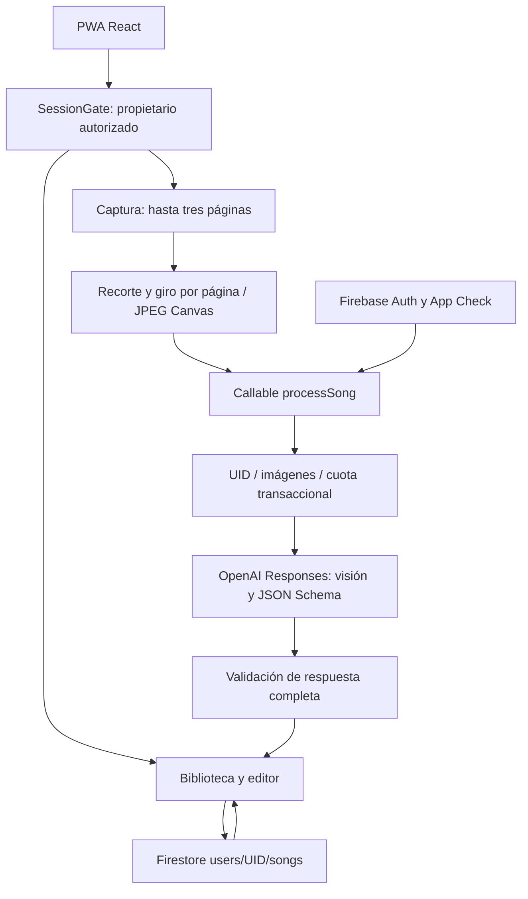

# Arquitectura · 0.2.0

## Sesión y datos

`SessionGate` verifica la sesión y el UID configurado antes de montar el espacio privado. Al cerrar o cambiar sesión, React desmonta su estado, incluidas letras y fotografías. Firestore mantiene caché en memoria; Firebase Auth administra sus propios datos de sesión.

Las canciones se guardan en `users/{uid}/songs/{songId}` con `title`, `content`, `favorite`, `category`, `createdAt`, `updatedAt` y `version`. Las reglas validan tipos, límites, timestamps de servidor y aumento de versión. Edición y favoritos usan transacciones; los conflictos de edición requieren reabrir la canción.

## Transcripción

Las imágenes permanecen en RAM y cada página conserva su recorte/rotación. Canvas limita la dimensión mayor a 1600 px y produce JPEG. La función verifica uno a tres JPEG, tamaño por imagen y total, Auth, UID y App Check.

Antes de llamar a IA reserva cuota mediante una transacción Admin SDK en `internalUsage/{uid}`: diez intentos por hora UTC, treinta por día UTC y diez segundos entre intentos. Los clientes no tienen acceso a esos documentos. La reserva también cuenta si falla posteriormente la API; así no se pueden generar reintentos ilimitados.

OpenAI recibe una solicitud de visión con JSON Schema, `store: false`, límite de tokens y timeout de 90 segundos. Se comprueban respuestas completas, negativas, JSON y tipos antes de devolver `{title, content, warnings}`. No se registra material de usuario ni claves en los errores. El usuario revisa y guarda la transcripción.

## Despliegue

`prepare-deploy.mjs` carga la configuración de producción y genera `.firebase/firestore.rules` desde la plantilla, además de sincronizar `OWNER_UID` en el entorno de Functions del proyecto. El frontend usa el mismo `VITE_OWNER_UID`. Se rechazan configuración incompleta, región incorrecta y proyecto CLI incoherente.

Hosting recompila producción en su hook; Functions recompila TypeScript; Firestore prepara las reglas antes de publicar. `npm run deploy` fija el proyecto explícitamente. Storage tiene configuración y reglas de denegación, pero no forma parte del despliegue habitual.

## PWA y verificación

El service worker precachea recursos de aplicación, sin caché runtime de canciones, API o imágenes. Las nuevas versiones muestran un aviso para guardar antes de recargar.

CI ejecuta unitarias/configuración, backend, builds, auditorías, reglas emuladas y E2E Chromium. El flujo Firebase→OpenAI real depende de credenciales y se valida después del primer despliegue, según `DEPLOYMENT.md`.
