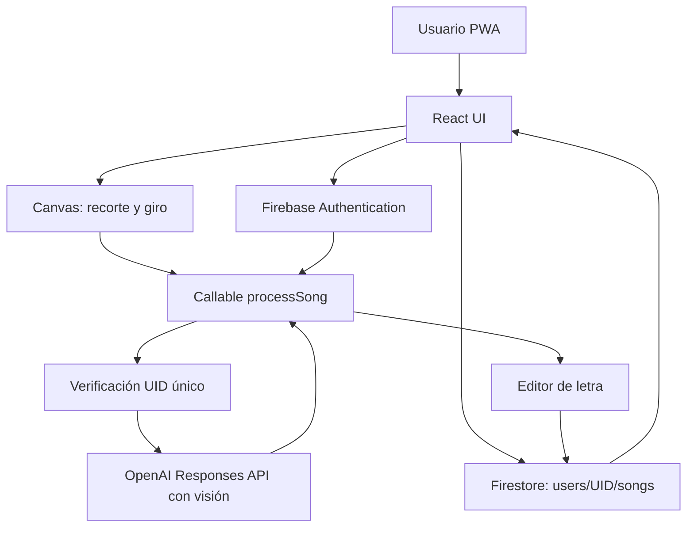

# ARQUITECTURA

## Modelo de datos implementado
Ruta: `users/{uid}/songs/{songId}`.
Campos: `title`, `content`, `category`, `favorite`, `createdAt`, `updatedAt`, `version`. La biblioteca extrae `Song.id` del ID del documento. El listado filtra en memoria la sesión actual del propietario y se actualiza con `onSnapshot`.

## Procesamiento real del MVP
- Cámara/galería -> Data URL temporal en RAM -> recorte rectangular + JPEG Canvas -> callable `processSong` (JSON con imágenes base64) -> Responses API -> JSON `{title,content,warnings}` -> editor -> `setDoc` Firestore.
- Los originales **no** se suben a Cloud Storage y **no** existe actualmente un sistema de trabajos con cola/reintentos persistentes.
- Cada intento invoca IA una sola vez. Claves secretas en Firebase Secret Manager mediante `defineSecret`.
- La función usa `defineString('OWNER_UID')` para un único propietario y un límite de 3 imágenes.
- El frontend guarda con transacciones y comprueba `version` al actualizar; otros cambios desde un segundo dispositivo ocasionan error que requiere reabrir la canción.

## Modelo futuro recomendado
- Storage temporal con TTL, funciones asíncronas, protección App Check obligatoria, cuotas de IA, registros técnicos sin contenido sensible.
- Persistir `processingJobs/{jobId}`, versiones y advertencias; mantener un contrato JSON estricto y verificación de calidad.
- Editor de perspectiva en cuatro puntos y correcciones por página sin sobrescribir el trabajo en páginas anteriores.
- Índices para búsqueda de contenido extensa, revisiones y backups automatizados.

## Privacidad
El navegador no persiste deliberadamente letras o fotografías de usuario. `memoryLocalCache()` de Firestore es explícito; service worker solo precachea archivos de aplicación. El navegador o sistema podrían generar cachés temporales propias. La demo es memoria volátil.

## Riesgos
1. Fotografía pequeña o borrosa: error IA; revisión siempre necesaria.
2. Backend callable: límites de tamaño; pasar a Storage temporal en próxima iteración.
3. PWA instalada en iOS: permisos e instalación dependen de Safari.
4. Acceso indebido: reglas y OWNER_UID deben configurarse correctamente y probarse.
5. Gastos IA: cuotas por implementar; no habilitar para múltiples cuentas.
